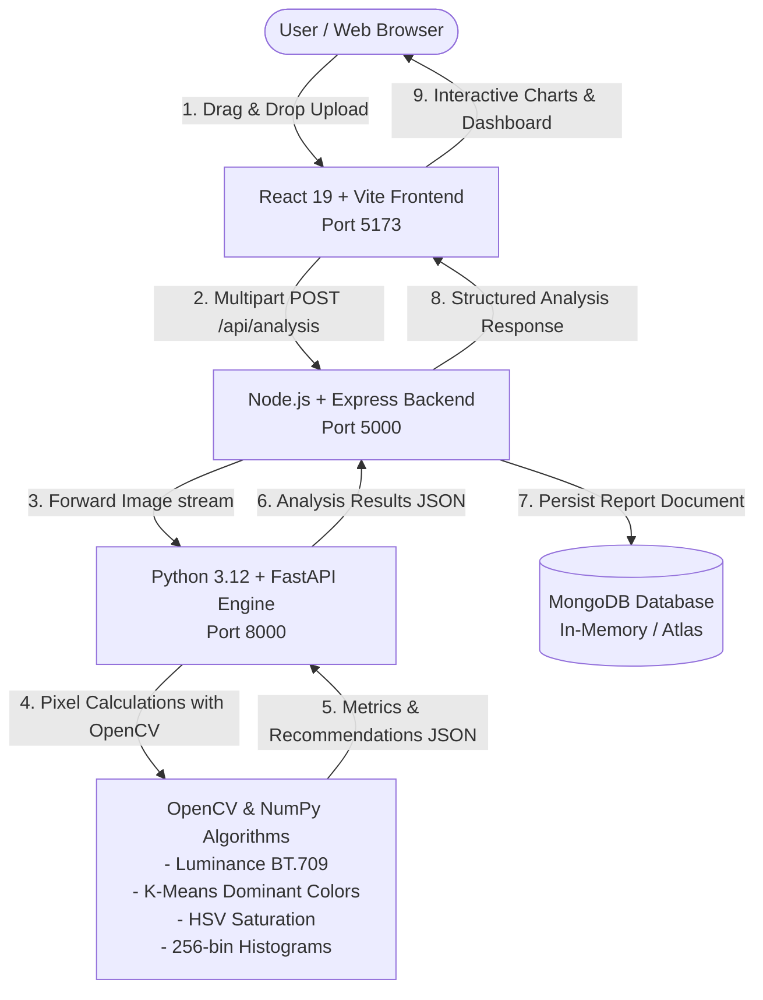

# Photo Color Grading Analyzer (FSD-2 Full-Stack Project)

> An intermediate-level, production-ready full-stack photography analytics web platform built with the MERN stack and a dedicated Python OpenCV computer vision microservice.

---

## 1. Project Overview

**Photo Color Grading Analyzer** allows photographers, visual artists, and colorists to upload any photograph and receive a comprehensive, objective breakdown of its visual and colorimetric characteristics.

Unlike subjective editors, this tool:
- Computes **exact mathematical metrics** directly from pixel data using OpenCV.
- Analyzes luminance distribution, dynamic range, and shadow/highlight clipping.
- Plots full **RGB and Luminance 256-bin area charts** with Recharts.
- Extracts the **top 5 dominant colors** with percentage shares and HEX palettes using native K-Means clustering.
- Estimates **color temperature casts** (warm vs. cool).
- Provides **rule-based editing recommendations** explaining why adjustments are needed.
- Automatically persists all reports in **MongoDB** with instant history recall and JSON export.

---

## 2. System Architecture



---

## 3. Technology Stack

| Layer | Technology | Role & Purpose |
|---|---|---|
| **Frontend** | React 19 + Vite | Fast Single-Page Application (SPA) with instant HMR |
| **Styling** | Tailwind CSS v4 | Polished, modern dark-themed photography UI |
| **Data Visualization** | Recharts | Interactive RGB & Luminance channel area charts |
| **Icons & UX** | Lucide React | High-contrast, clean icons |
| **HTTP Client** | Axios | Frontend-to-backend communication with progress tracking |
| **API Backend** | Node.js + Express.js | REST API, rate limiting, file validation, security |
| **Uploads** | Multer | Streaming multipart image handling with automatic cleanup |
| **Database** | MongoDB + Mongoose | Schema validation, report history, document persistence |
| **Analysis Engine** | Python 3.12 + FastAPI | High-performance computer vision microservice |
| **Image Processing** | OpenCV (opencv-python-headless) | Real pixel calculations, color-space conversions, K-Means |
| **Scientific Math** | NumPy | Matrix operations, histograms, standard deviation |

---

## 4. Mathematical Formulas & Image Processing Algorithms

### A. Mean Luminance & Brightness (ITU-R BT.709)
Per-pixel luminance $Y$ is calculated using the standard high-definition television and digital imaging coefficient weighting:
$$Y = 0.2126 \cdot R + 0.7152 \cdot G + 0.0722 \cdot B$$
- Pixel values are normalized from $[0, 255]$ to a $[0, 100]$ scale.
- Mean brightness: $\bar{Y} = \frac{1}{N} \sum_{i=1}^{N} Y_i$

### B. Dynamic Range & Contrast
Contrast is measured via the standard deviation of the luminance channel:
$$\sigma_Y = \sqrt{\frac{1}{N} \sum_{i=1}^{N} (Y_i - \bar{Y})^2}$$
- Low contrast images display $\sigma_Y < 30$.
- High contrast images display $\sigma_Y > 75$.

### C. Saturation Distribution (HSV Color Space)
The image is converted to the cylindrical HSV (Hue, Saturation, Value) color model:
$$S = \begin{cases} 0 & \text{if } \max(R,G,B) = 0 \\ 1 - \frac{\min(R,G,B)}{\max(R,G,B)} & \text{otherwise} \end{cases}$$
The saturation channel is segmented into low ($<25\%$), mid ($25-75\%$), and high ($>75\%$) buckets.

### D. Shadow, Highlight & Clipping Thresholds
- **Deep Shadows**: $Y < 30$ ($<11.8\%$)
- **Shadows**: $Y < 60$ ($<23.5\%$)
- **Midtones**: $60 \le Y \le 195$ ($23.5\% - 76.5\%$)
- **Highlights**: $Y > 195$ ($>76.5\%$)
- **Bright Highlights**: $Y > 225$ ($>88.2\%$)
- **Black Clipping**: $Y \le 5$ (indicates crushed shadow detail)
- **White Clipping**: $Y \ge 250$ (indicates blown highlight detail)

### E. Dominant Colors (K-Means Clustering)
- Pixel color space is treated as a 3D Euclidean coordinate system $(R, G, B)$.
- The image is sampled and clustered into $K = 5$ centroids using OpenCV's optimized C++ implementation:
$$\min \sum_{j=1}^{K} \sum_{x \in S_j} \|x - \mu_j\|^2$$
- Each cluster centroid is converted to standard RGB and HEX notation (`#RRGGBB`).
- Relative pixel cluster membership determines each color's percentage share.

### F. Color Temperature Estimation
Color cast is estimated via relative channel balance:
$$\text{Warmth Index} = \bar{R} - \bar{B}$$
- Values $> +10$ indicate a warm cast (golden hour, incandescent light).
- Values $< -10$ indicate a cool cast (overcast sky, blue hour, fluorescent light).

### G. Technical Image Quality & Focus Analysis
- **Focus & Sharpness**: Measured via the discrete 2D Laplacian operator variance:
$$\text{Sharpness} = \operatorname{Var}\left(\nabla^2 I\right) = \operatorname{Var}\left(\frac{\partial^2 I}{\partial x^2} + \frac{\partial^2 I}{\partial y^2}\right)$$
  - $\text{Var} < 80$: Soft focus / motion blur.
  - $\text{Var} > 250$: Sharp & crisp in-focus image.
- **ISO Noise & Grain**: Calculated from the standard deviation $\sigma_{\text{noise}}$ of high-frequency residuals between raw grayscale and Gaussian blurred ($\sigma = 1.0$) representations.
- **Clarity Index**: Integrated composite score normalized between 0 and 100.

### H. Lighting Style & Dynamic Range Analysis
- **Tonal Dynamic Range**: Span between 1st percentile and 99th percentile luminance, translated into photographic exposure value ($EV$) stops:
$$EV_{\text{stops}} = \log_2\left(\max\left(1.0, \frac{P_{99} - P_1}{2.0}\right)\right)$$
- **Key Lighting Identification**:
  - **High-Key**: Mean luminance $> 170$ with $< 8\%$ deep shadows and $> 25\%$ bright highlights.
  - **Low-Key**: Mean luminance $< 85$ with $> 30\%$ deep shadows (dramatic chiaroscuro lighting).
  - **Balanced Key**: Evenly distributed natural commercial / portrait lighting.
- **Lens Vignette Falloff**: Percentage delta between peripheral 15% corner luminance and central 30% frame luminance:
$$\text{Falloff \%} = \frac{\bar{Y}_{\text{corners}} - \bar{Y}_{\text{center}}}{\max(\bar{Y}_{\text{center}}, 1.0)} \times 100$$

### I. Color Harmony Classification
Identifies relationships among dominant colors on the $360^\circ$ color wheel:
- **Complementary**: Dominant hues separated by $180^\circ \pm 35^\circ$ (e.g. classic cinematic Teal & Orange).
- **Analogous**: Dominant hues confined within a contiguous $75^\circ$ sector.
- **Triadic**: Dominant hues distributed evenly at $\sim 120^\circ$ intervals.
- **Monochromatic**: Singular hue family varying in saturation and value ($< 35^\circ$ angular spread).

---

## 5. Folder Structure

```
photo-color-grading-analyzer/
│
├── client/                      # React 19 + Vite Frontend
│   ├── src/
│   │   ├── components/          # Reusable UI widgets
│   │   │   ├── Navbar.jsx
│   │   │   ├── MetricCard.jsx
│   │   │   ├── RgbHistogram.jsx
│   │   │   ├── LuminanceHistogram.jsx
│   │   │   ├── DominantColors.jsx
│   │   │   ├── ShadowHighlightBar.jsx
│   │   │   └── Recommendations.jsx
│   │   ├── pages/               # Application views
│   │   │   ├── HomePage.jsx
│   │   │   ├── UploadPage.jsx
│   │   │   ├── ReportPage.jsx
│   │   │   └── HistoryPage.jsx
│   │   ├── services/
│   │   │   └── api.js           # Central Axios HTTP service
│   │   ├── App.jsx              # Routing configuration
│   │   ├── main.jsx             # React DOM entry point
│   │   └── index.css            # Tailwind CSS styling
│   ├── index.html
│   ├── vite.config.js
│   ├── package.json
│   └── .env.example
│
├── server/                      # Express.js REST API
│   ├── src/
│   │   ├── config/
│   │   │   ├── db.js            # MongoDB & In-Memory fallback
│   │   │   └── env.js           # Environment loader
│   │   ├── controllers/
│   │   │   └── analysisController.js
│   │   ├── middleware/
│   │   │   └── upload.js        # Multer disk storage & sanitization
│   │   ├── models/
│   │   │   └── Analysis.js      # Mongoose schema
│   │   ├── routes/
│   │   │   └── analysis.js      # API routes
│   │   ├── services/
│   │   │   └── analyzerService.js # Python microservice proxy
│   │   ├── app.js               # Express application config
│   │   └── server.js            # Server entry point
│   ├── test_integration.js      # Automated backend tests
│   ├── package.json
│   └── .env.example
│
├── analyzer/                    # Python FastAPI OpenCV Engine
│   ├── app/
│   │   ├── analysis/
│   │   │   └── metrics.py       # Core OpenCV calculations
│   │   ├── api/
│   │   │   └── routes.py        # /analyze and /health endpoints
│   │   ├── core/
│   │   │   └── image_loader.py  # Pillow image decoding & validation
│   │   ├── recommendations/
│   │   │   └── engine.py        # Rule-based photo advice
│   │   └── main.py              # FastAPI application entry
│   ├── tests/
│   │   └── test_analysis.py     # 17 Unit test cases
│   ├── run_tests.py             # Test execution runner
│   ├── requirements.txt
│   ├── pytest.ini
│   └── .env.example
│
├── start-all.bat                # 1-Click Windows launcher for all 3 services
├── .gitignore
└── README.md                    # Project documentation
```

---

## 6. How to Run Locally

### Prerequisites
- **Node.js**: v18+ (tested on Node v24)
- **Python**: v3.10+ (tested on Python 3.12)
- **MongoDB**: (Optional) If MongoDB is not installed locally, the backend automatically boots an in-memory MongoDB instance with zero configuration required!

### Option 1: 1-Click Launch (Recommended on Windows)
Simply double-click:
```powershell
.\start-analyzer.bat
```
or run from PowerShell:
```powershell
cd photo-color-grading-analyzer
.\start-all.bat
```
This opens 3 dedicated terminal windows for the Python engine, Express backend, and React frontend.

---

### Option 2: Manual Terminal Launch

#### Terminal 1 — Python Analyzer (Port 8000)
```powershell
cd photo-color-grading-analyzer\analyzer
python -m uvicorn app.main:app --host 127.0.0.1 --port 8000
```
*Health Check: http://127.0.0.1:8000/health*

#### Terminal 2 — Express Backend (Port 5000)
```powershell
cd photo-color-grading-analyzer\server
npm start
```
*Health Check: http://localhost:5000/health*

#### Terminal 3 — React Frontend (Port 5173)
```powershell
cd photo-color-grading-analyzer\client
npm run dev
```
*Web App: http://localhost:5173*

---

## 7. Testing & Verification

### Running Python Unit Tests (17 Tests)
```powershell
cd photo-color-grading-analyzer\analyzer
python run_tests.py
```
**Output:**
```
============================================================
Running Photo Color Grading Analyzer Tests
============================================================
[PASS] Brightness calculations (black, white, midgray)
[PASS] Contrast calculations (flat low-contrast, checkerboard)
[PASS] Saturation calculations (grayscale, saturated color)
[PASS] Histograms (RGB 256 bins, luminance 256 bins)
[PASS] Shadows & Highlights (shadow pct, highlight pct, clipping)
[PASS] Dominant colors (OpenCV K-means, top 5 colors, percentages)
[PASS] Color temperature (warm, cool, neutral estimation)
============================================================
ALL 17 UNIT TESTS PASSED SUCCESSFULLY!
============================================================
```

### Running Backend Integration Tests (6 Tests)
```powershell
cd photo-color-grading-analyzer\server
node test_integration.js
```
**Output:**
```
==================================================
Photo Color Grading Analyzer - Integration Tests
==================================================
[PASS] 1. Express backend health check (/health)
[PASS] 2. Python OpenCV analyzer health check (/health)
[PASS] 3. Get analysis history (found reports)
[PASS] 4. Non-image file upload correctly rejected with 400/error
[PASS] 5. Invalid MongoDB ID correctly rejected with 400
[PASS] 6. Non-existent MongoDB ID correctly returned 404
==================================================
Summary: 6 passed, 0 failed
==================================================
```

---

## 8. REST API Reference

| Method | Endpoint | Description | Request Body | Response |
|---|---|---|---|---|
| `GET` | `/health` | Express server status | None | `{"status": "ok"}` |
| `POST` | `/api/analysis` | Upload & analyze photo | `multipart/form-data` with `image` file | Full analysis document (HTTP 201) |
| `GET` | `/api/analysis` | Fetch saved analysis history | None (supports `?page=1&limit=20`) | Array of past reports |
| `GET` | `/api/analysis/:id` | Fetch single report | None | Analysis document |
| `DELETE` | `/api/analysis/:id` | Delete report from database | None | `{"message": "deleted"}` |
| `GET` | `http://127.0.0.1:8000/health` | Python microservice health | None | `{"status": "ok"}` |
| `POST` | `http://127.0.0.1:8000/analyze` | Raw image calculation engine | `multipart/form-data` with `file` | Metrics JSON |

---

## 9. Security & Error Handling

- **MIME & Content Validation**: Uses Pillow byte inspection (`Image.verify()`) to guarantee authentic JPEG, PNG, or WebP files rather than relying solely on file extensions.
- **Resource Protection**: Maximum upload size enforced at 20MB in both Multer and FastAPI.
- **Path Traversal Prevention**: User filenames are never stored directly on disk; random 32-character hexadecimal hashes are assigned during staging.
- **Zero Orphaned Files**: Uploaded image buffers are deleted immediately after analysis completes.
- **Rate Limiting**: Express API is protected with `express-rate-limit` (100 requests per 15 minutes).
- **HTTP Headers**: Enforces strict security headers using `helmet`.

---

## 10. Deployment Instructions

### 1. MongoDB Database
Create a free database cluster on [MongoDB Atlas](https://www.mongodb.com/cloud/atlas):
1. Create a database named `photo-analyzer`.
2. Copy your connection string: `mongodb+srv://<username>:<password>@cluster0.mongodb.net/photo-analyzer`.

### 2. Python Service (Render or Railway)
Deploy `analyzer/`:
- Root Directory: `photo-color-grading-analyzer/analyzer`
- Build Command: `pip install -r requirements.txt`
- Start Command: `uvicorn app.main:app --host 0.0.0.0 --port $PORT`

### 3. Express Backend (Render, Railway, or Heroku)
Deploy `server/`:
- Root Directory: `photo-color-grading-analyzer/server`
- Environment Variables:
  - `PORT=5000`
  - `MONGODB_URI=<your-atlas-uri>`
  - `ANALYZER_URL=<deployed-python-url>`
  - `CLIENT_ORIGIN=<deployed-react-url>`

### 4. React Frontend (Vercel)
Deploy `client/`:
- Root Directory: `photo-color-grading-analyzer/client`
- Build Command: `npm run build`
- Output Directory: `dist`
- Environment Variable: `VITE_API_BASE_URL=<deployed-express-url>`

---

## 11. Project Summary for College Viva / FSD-2 Demo

- **What problem does this solve?** Photographers often lack objective feedback on their color grading, exposure balance, and dynamic range. This app provides algorithmic analysis without needing expensive, subjective photo editing suites.
- **Why MERN / Java JSP + Python?** Node.js or JavaServer Pages delivers robust full-stack architecture, while Python with OpenCV delivers industrial-strength C++ computer vision performance for pixel math and clustering.
- **Is ML used?** No heavy AI training is required. The system leverages deterministic image processing (ITU-R BT.709 luminance, HSV color space transformation, OpenCV K-Means clustering, and 256-bin histogram calculus).
- **Key Highlight:** Zero-configuration local database fallback ensures the app runs out-of-the-box on any machine without installing complex external database servers.

---

## 12. Alternative Java JSP Backend (`jsp-backend/`)

In addition to the Node/Express backend, the application features an enterprise-grade **JavaServer Pages (JSP) and Jakarta Servlets 6 backend** built for Apache Tomcat 10.

### Architecture & Features:
- **Zero-Dependency Core**: Compiles directly with standard JDK 11+ (`javac`) without heavy build systems or external JARs.
- **Jakarta Servlets 6**:
  - `AnalysisServlet` (`/analyze`, `/report`): Handles multipart photo uploads, invokes the Python microservice, generates base64 image data URLs, and forwards to `report.jsp`.
  - `HistoryServlet` (`/history`): Retrieves past analyses from `AnalysisDAO` and renders `history.jsp`.
  - `DeleteServlet` (`/delete`): Deletes saved reports.
  - `ApiAnalysisServlet` (`/api/analysis/*`): Full REST API endpoint with CORS headers matching Node/Express routes so the React SPA can also connect directly to Tomcat.
  - `HealthServlet` (`/health`): Health probe reporting service status and Python engine connectivity.
- **JSP Presentation Layer**:
  - `index.jsp`: Modern hero landing page with feature cards and full-stack workflow diagrams.
  - `upload.jsp`: Drag-and-drop file upload with live client-side image preview (dimensions, file size, thumbnail).
  - `report.jsp`: Full analytics dashboard featuring interactive HTML5 Canvas 256-bin RGB and Luminance histograms, 5 K-Means dominant color swatches, focus sharpness, dynamic range EV stops, lens vignette falloff, and color grading recommendations.
  - `history.jsp`: Tabular history log with image thumbnails, color harmony tags, and 1-click report view or deletion.
- **Thread-Safe Persistence (`AnalysisDAO`)**: Automatically persists reports and image previews to `~/.photoanalyzer/reports.json`.

### How to Run the JSP Backend:
1. Make sure Tomcat 10 is available (configured on port `8081`).
2. Run the one-click startup script:
   ```cmd
   cd photo-color-grading-analyzer
   run_jsp.bat
   ```
3. Open in your browser:
   - **http://localhost:8081/photo-analyzer/** (or **http://localhost:8081/**)


